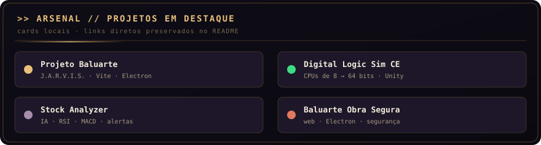
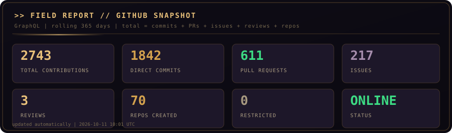
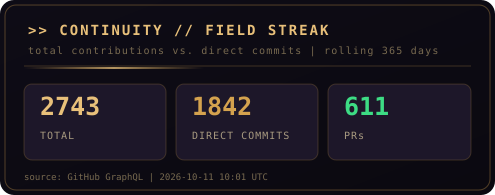
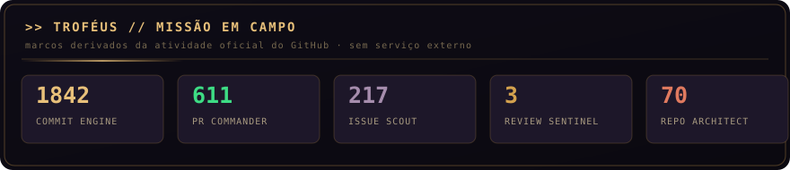
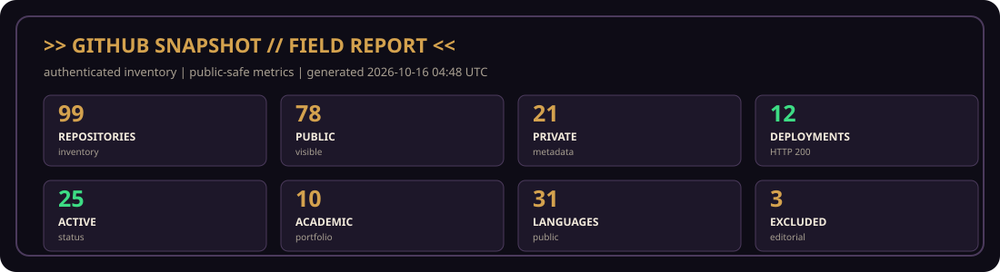

<div align="center">


[](https://github.com/Lucas-Belucci-Bellini/Projeto-Baluarte)


[](https://github.com/Lucas-Belucci-Bellini)
[](https://unifil.br)
[](#)
[](https://github.com/Lucas-Belucci-Bellini/Lucas-Belucci-Bellini/tree/template/readme-style-kit)

**Estudante de Ciência da Computação e desenvolvedor de sistemas, aplicações web,
IA, jogos, automação e hardware.**

Transformo ideias em produtos, experiências e sistemas que podem ser executados,
testados e evoluídos.

[](#produtos)
[](#sites)
[](#ecossistema)
[](#contato)

</div>

---

```text
╔══════════════════════════════════════════════════════════════╗
║   BALUARTE // FIELD MANUAL — VOLUME I                        ║
║   ──────────────────────────────────────────────────────     ║
║   >> Agente    : Lucas Belucci Bellini                       ║
║   >> Codinome  : Spartan Gamer BR                            ║
║   >> Base      : Londrina, Paraná, Brasil                    ║
║   >> Missão    : Ciência da Computação / UNIFIL              ║
║   >> Arsenal   : Programação · Robótica · Eletrônica         ║
║   >> Status    : EM CAMPO — OPERACIONAL .........[OK]        ║
╚══════════════════════════════════════════════════════════════╝
```

## `// COMECE POR AQUI` · START HERE

| | |
|:---|:---|
| **[▸ Produtos em destaque](#produtos)** | o que dá para abrir agora, com botão de entrada |
| **[🌐 Sites no ar](#sites)** | o diretório de deployments conferidos por requisição HTTP |
| **[◈ Ecossistema completo](#ecossistema)** | como os projetos se conectam |
| **[⚙ Tecnologias](#arsenal)** | linguagens, frameworks e ferramentas de verdade em uso |
| **[▤ Engenharia](#engenharia)** | atividade, métricas e o inventário completo |

## `// FICHA DE AGENTE` · PT-BR

Sou **Lucas Belucci Bellini**, também conhecido como **Spartan Gamer BR**. Estudo **Ciência da Computação na UNIFIL**, em Londrina/PR, e gosto de transformar ideias em sistemas que possam ser vistos, testados e melhorados.

Minha linha de construção vai de **CPUs de 8 a 64 bits feitas do zero** — porta lógica por porta lógica — até **aplicações web, agentes de IA, simulações, automações, projetos de hardware e jogos**. Gosto de explorar tecnologias novas, documentar o processo e terminar o que começo.

### `// AGENT FILE` · EN-US

I am **Lucas Belucci Bellini**, also known as **Spartan Gamer BR**. I study **Computer Science at UNIFIL** in Londrina, Brazil, and I turn ideas into systems that can be explored, tested and improved.

My work ranges from **8-to-64-bit CPUs built from scratch** to **web applications, AI agents, simulations, automation, hardware projects and games**. I enjoy exploring new technologies, documenting the process and finishing what I start.

## `// O QUE EU CONSTRUO` · WHAT I BUILD

<!-- WHAT-I-BUILD:START -->
<table>
<tr>
<td width="33%" valign="top" align="center">

### 🌐

**WEB & SAAS**

<sub>Plataformas, ferramentas e produtos web publicados.</sub>

`41 projetos` · `10 com site`

<sub>ex.: baluarte-obra-segura</sub>

</td>
<td width="33%" valign="top" align="center">

### 🤖

**AI & AUTOMATION**

<sub>Agentes, automação e sistemas de conhecimento.</sub>

`4 projetos` · `1 com site`

<sub>ex.: DailyPlanner</sub>

</td>
<td width="33%" valign="top" align="center">

### ⚙

**HARDWARE & LOGIC**

<sub>Lógica digital, CPUs do zero e eletrônica.</sub>

`4 projetos` · `1 com site`

<sub>ex.: Veritas</sub>

</td>
</tr>
<tr>
<td width="33%" valign="top" align="center">

### 🎮

**GAMES & WORLDS**

<sub>Jogos, simulações e mundos jogáveis.</sub>

`6 projetos` · `0 com site`

<sub>ex.: Recycle-game</sub>

</td>
<td width="33%" valign="top" align="center">

### 🛠

**TOOLS & SYSTEMS**

<sub>Utilitários, scripts e infraestrutura de apoio.</sub>

`11 projetos` · `0 com site`

<sub>ex.: Teste-aula-git</sub>

</td>
<td width="33%" valign="top" align="center">

### 🎓

**ACADEMIC & LABS**

<sub>Trabalhos de curso, estudos dirigidos e experimentos.</sub>

`12 projetos` · `0 com site`

<sub>ex.: Academic-Portfolio</sub>

</td>
</tr>
</table>
<!-- WHAT-I-BUILD:END -->

<a id="produtos"></a>

## `// PRODUTOS EM DESTAQUE` · FEATURED PRODUCTS

> `VITRINE` · o que dá para abrir agora. Cada cartão traz a categoria, o que o projeto
> entrega e o estado do deployment conferido na auditoria — **nenhum selo `SITE VERIFICADO`
> é escrito à mão**, todos saem da verificação HTTP.

<!-- PRODUCT-CARDS:START -->
<table>
<tr>
<td width="50%" valign="top">

<sub>`DIGITAL LOGIC / HARDWARE`</sub>

### Veritas

Calculadora de tabelas verdade e ferramenta local-first para projetar circuitos lógicos, com editor visual, simulação e MCP documentados.


[](https://veritas-opal-seven.vercel.app) [](https://github.com/Lucas-Belucci-Bellini/Veritas)

</td>
<td width="50%" valign="top">

<sub>`ECOSSISTEMA BALUARTE`</sub>

### baluarte-obra-segura

Hub de engenharia para gestão de obras, editor de painéis elétricos, calculadoras e base WikiBuild, conforme a descrição pública.


[](https://baluarte-obra-segura.vercel.app) [](https://github.com/Lucas-Belucci-Bellini/baluarte-obra-segura)

</td>
</tr>
<tr>
<td width="50%" valign="top">

<sub>`ECOSSISTEMA BALUARTE`</sub>

### Project-Vanguard

GPS topográfico tático e computador de tiro em JavaScript/Vite/MapLibre GL, conforme o README público.


[](https://project-vanguard-cyan.vercel.app) [](https://github.com/Lucas-Belucci-Bellini/Project-Vanguard)

</td>
<td width="50%" valign="top">

<sub>`IA & AUTOMAÇÃO`</sub>

### DailyPlanner

Agenda diária em TypeScript/Vite para cadastrar, editar, concluir, excluir, buscar e filtrar atividades no navegador.


[](https://daily-planner-phi-smoky.vercel.app) [](https://github.com/Lucas-Belucci-Bellini/DailyPlanner)

</td>
</tr>
<tr>
<td width="50%" valign="top">

<sub>`ECOSSISTEMA BALUARTE`</sub>


</td>
<td width="50%" valign="top">

<sub>`WEB`</sub>

### CodeVibe-Academy

Descrição pública não informada.


[](https://code-vibe-academy.vercel.app) [](https://github.com/Lucas-Belucci-Bellini/CodeVibe-Academy)

</td>
</tr>
</table>
<!-- PRODUCT-CARDS:END -->

## `// MISSÕES EM DESTAQUE` · FEATURED MISSIONS

> `REGRA DE ACESSO` · **▸ Abrir site** vem primeiro quando o projeto tem um deployment que
> respondeu na auditoria; **código** é o link secundário, para quem quer ver como foi feito.
> Projeto sem site publica só o código — nenhuma linha anuncia um endereço que não respondeu.

<!-- FEATURED-PROJECTS:START -->
> Uma seleção editorial das frentes que melhor representam a construção do ecossistema: produto, lógica digital, engenharia, IA, web e jogos.

| # | Missão | O que a evidência pública confirma | Status | Acesso |
|:--:|:---|:---|:---|:---|
| 2 | **DIGITAL LOGIC / LOCAL-FIRST** · Veritas | Calculadora de tabelas verdade e projetista de circuitos com editor visual, simulação e integrações documentadas. | 🟢 Active | **[▸ Abrir site](https://veritas-opal-seven.vercel.app)** · [código](https://github.com/Lucas-Belucci-Bellini/Veritas) |
| 3 | **ENGINEERING / FIELD TOOL** · baluarte-obra-segura | Hub de engenharia para obras com editor de painéis, calculadoras, simuladores e base WikiBuild. | 🟡 In Development | **[▸ Abrir site](https://baluarte-obra-segura.vercel.app)** · [código](https://github.com/Lucas-Belucci-Bellini/baluarte-obra-segura) |
| 4 | **TACTICAL WEB / MAPS** · Project-Vanguard | GPS topográfico tático e computador de tiro construído com stack web e visualização geográfica. | 🟢 Active | **[▸ Abrir site](https://project-vanguard-cyan.vercel.app)** · [código](https://github.com/Lucas-Belucci-Bellini/Project-Vanguard) |
| 5 | **CPU BUILD / SIMULATION** · Digital-Logic-Sim-CE | Simulação de lógica digital que documenta a linha de construção de computadores e chips funcionais. | 🔵 Experimental | [código](https://github.com/Lucas-Belucci-Bellini/Digital-Logic-Sim-CE) |
| 6 | **WEB APP / PRODUCTIVITY** · DailyPlanner | Agenda web em TypeScript para organizar, buscar, filtrar e concluir atividades no navegador. | 🟢 Active | **[▸ Abrir site](https://daily-planner-phi-smoky.vercel.app)** · [código](https://github.com/Lucas-Belucci-Bellini/DailyPlanner) |
| 8 | **WEB** · Ark-Initiative | Conceito ARCA de infraestrutura de resiliência climática e ambiental, com visão pública de dados, simulação e resposta. | 🟡 In Development | [código](https://github.com/Lucas-Belucci-Bellini/Ark-Initiative) |
| 9 | **DIGITAL LOGIC / HARDWARE** · CHIPS-Digital-Logic-Sim-Lucas-Belucci | Coleção pública de chips e testes de lógica digital. | 🟡 In Development | [código](https://github.com/Lucas-Belucci-Bellini/CHIPS-Digital-Logic-Sim-Lucas-Belucci) |
| 10 | **GAMES** · Recycle-game | Jogo educativo de reciclagem e automação com protótipo jogável documentado. | 🟡 In Development | [código](https://github.com/Lucas-Belucci-Bellini/Recycle-game) |
<!-- FEATURED-PROJECTS:END -->

<a id="sites"></a>

## `// SITES NO AR` · LIVE WEBSITES

<!-- WEBSITE-DIRECTORY:START -->
> **12 sites no ar** · cada link foi conferido por requisição HTTP nesta auditoria.

<div align="center">

[](https://baluarte-obra-segura.vercel.app)
[](https://code-vibe-academy.vercel.app)
[](https://daily-planner-phi-smoky.vercel.app)
[](https://essence-custom-furniture.vercel.app)
[](https://hydralauncher.gg)
[](https://llbr-innovations-constructions.vercel.app)
[](https://web-2qfw.vercel.app)
[](https://project-vanguard-cyan.vercel.app)
[](https://rea.tools)
[](https://veritas-opal-seven.vercel.app)

</div>
<!-- WEBSITE-DIRECTORY:END -->

<!-- LIVE-PROJECTS:START -->
| Projeto | Website | Verificação | Código |
|:---|:---|:---:|:---|
| **baluarte-obra-segura** | **[▸ Abrir site](https://baluarte-obra-segura.vercel.app)** | `HTTP 200` | [código](https://github.com/Lucas-Belucci-Bellini/baluarte-obra-segura) |
| **CodeVibe-Academy** | **[▸ Abrir site](https://code-vibe-academy.vercel.app)** | `HTTP 200` | [código](https://github.com/Lucas-Belucci-Bellini/CodeVibe-Academy) |
| **DailyPlanner** | **[▸ Abrir site](https://daily-planner-phi-smoky.vercel.app)** | `HTTP 200` | [código](https://github.com/Lucas-Belucci-Bellini/DailyPlanner) |
| **Essence-Custom-Furniture** | **[▸ Abrir site](https://essence-custom-furniture.vercel.app)** | `HTTP 200` | [código](https://github.com/Lucas-Belucci-Bellini/Essence-Custom-Furniture) |
| **hydra** | **[▸ Abrir site](https://hydralauncher.gg)** | `HTTP 200` | [código](https://github.com/Lucas-Belucci-Bellini/hydra) |
| **LLBR-Innovations-Constructions** | **[▸ Abrir site](https://llbr-innovations-constructions.vercel.app)** | `HTTP 200` | [código](https://github.com/Lucas-Belucci-Bellini/LLBR-Innovations-Constructions) |
| **NEXORA** | **[▸ Abrir site](https://web-2qfw.vercel.app)** | `HTTP 200` | [código](https://github.com/Lucas-Belucci-Bellini/NEXORA) |
| **Project-Vanguard** | **[▸ Abrir site](https://project-vanguard-cyan.vercel.app)** | `HTTP 200` | [código](https://github.com/Lucas-Belucci-Bellini/Project-Vanguard) |
| **rea** | **[▸ Abrir site](https://rea.tools)** | `HTTP 200` | [código](https://github.com/Lucas-Belucci-Bellini/rea) |
| **Veritas** | **[▸ Abrir site](https://veritas-opal-seven.vercel.app)** | `HTTP 200` | [código](https://github.com/Lucas-Belucci-Bellini/Veritas) |
<!-- LIVE-PROJECTS:END -->

> **Critério:** um deployment só aparece aqui quando a URL declarada respondeu durante a auditoria
> (`200`, ou um redirecionamento cujo destino respondeu). URL que falha some desta tabela e o
> projeto volta a apresentar só o código nas demais seções — a queda de um site nunca vira link quebrado.
>
> A URL sai da `homepage` declarada no GitHub e, quando ela está vazia, de
> [`docs/README_SITES.json`](README_SITES.json). **Nenhuma URL é deduzida do nome do repositório.**
> O resultado completo, legível por máquina, fica em [`docs/project-catalog.json`](project-catalog.json).

<a id="baluarte"></a>

## `// ECOSSISTEMA-FAROL` · FLAGSHIP: PROJETO BALUARTE

<div align="center">


</div>

lógica digital e experiências interativas sob um ecossistema só.

```text
BALUARTE
├── J.A.R.V.I.S. ......... assistente: modos local e web, memória e sessões
├── Git Nexus ............ navegação e ação sobre o próprio repositório
├── Veritas .............. lógica digital, tabelas verdade e circuitos
├── Obra Segura .......... engenharia de obras, painéis e WikiBuild
├── Vanguard Field ....... navegação civil offline-first, GPS e MGRS
├── World Game ........... sobrevivência, construção e consequência
└── módulos futuros ...... IDE web, Knowledge Engine, MCP
```

> abaixo apontam para o código enquanto o site não volta — a mesma regra que vale para
> os cards vale aqui: nenhuma linha anuncia um endereço que não respondeu.

<div align="center">



</div>


## `// NÚCLEO J.A.R.V.I.S.` · VISUAL CORE

<div align="center">


</div>


## `// DIGITAL LOGIC SIM` · CPU BUILD LOG

```text
╔══════════════════════════════════════════════════════════════╗
║   DIGITAL LOGIC SIM — CPU BUILD LOG                          ║
║   Computadores funcionais do zero, porta lógica por porta     ║
╠══════════════════════════════════════════════════════════════╣
║   [######################]   8-BIT CPU ....[CONCLUÍDO]       ║
║   [######################]  16-BIT CPU ....[CONCLUÍDO]       ║
║   [######################]  32-BIT CPU ....[CONCLUÍDO]       ║
║   [######################]  64-BIT CPU ....[CONCLUÍDO]       ║
╚══════════════════════════════════════════════════════════════╝
```

Construí computadores funcionais de **8 a 64 bits** no Digital Logic Sim — da ULA à arquitetura completa, uma porta lógica por vez.

<a id="ecossistema"></a>

## `// ECOSSISTEMA DIGITAL` · DIGITAL ECOSYSTEM

> `MISSION BOARD // ARCHITECTURE` · o mapa completo fica recolhido para manter a primeira leitura rápida.

<!-- ECOSYSTEM-MAP:START -->
```text
ECOSSISTEMA
│
│
├── Web ........................  9 projetos · 5 com site
│   └─ CodeVibe-Academy ● · Essence-Custom-Furniture ● · NEXORA ● · hydra ● · +5
│
├── Digital Logic / Hardware ...  4 projetos · 1 com site
│   └─ Veritas ● · Digital-Logic-Sim-CE · CHIPS-Digital-Logic-Sim-Lucas-Belucci · UMBRA-LIMA-ALFA
│
├── IA & Automação .............  4 projetos · 1 com site
│   └─ DailyPlanner ● · AI-second-brain-with-Claude-and-Obsidian · All-Skills-for-the-claude-code · Kizeo-Forms
│
├── Software & Ferramentas ..... 11 projetos · 0 com site
│   └─ All-The-Mods-10 · Ativ-Met-Ageis · Cookie-Clicker-Bot · Cosmos · +7
│
├── Academia ................... 10 projetos · 0 com site
│   └─ Academic-Portfolio · Atividade-6 · Decision-Structures · Flowgorithm- · +6
│
│   └─ Recycle-game · Catacombs-of-Paris-Ossuary-Escape-game-design · G-mod-Black-mesa · MOD-PACK-MINE-BACKUP · +2
│
└── Experimentos ...............  2 projetos · 0 com site
    └─ Ativ.-Geren-Proj · Projeto_01_endless_gnome
```

> `●` marca projeto com site verificado nesta auditoria. Os ramos usam os rótulos editoriais que o README já exibe; o equivalente canônico, para reuso externo, está em [`docs/project-catalog.json`](project-catalog.json). Repositórios privados não entram no mapa público.
<!-- ECOSYSTEM-MAP:END -->

<!-- PROJECT-MAP:START -->
<details>
<summary><b>⌁ Complete project map</b></summary>

| Projeto | Categoria | Stack | Status | Acesso |
|:---|:---|:---|:---|:---|
| **Academic-Portfolio** | Academia | `JavaScript` `HTML` | 🟣 Academic | [código](https://github.com/Lucas-Belucci-Bellini/Academic-Portfolio) |
| **AI-second-brain-with-Claude-and-Obsidian** | IA & Automação | `Shell` | 🟡 In Development | [código](https://github.com/Lucas-Belucci-Bellini/AI-second-brain-with-Claude-and-Obsidian) |
| **All-Skills-for-the-claude-code** | IA & Automação | `Python` `JavaScript` `TypeScript` `HTML` `Shell` | 🟢 Active | [código](https://github.com/Lucas-Belucci-Bellini/All-Skills-for-the-claude-code) |
| **All-The-Mods-10** | Software & Ferramentas | `GLSL` `JavaScript` `Shell` | 🟢 Active | [código](https://github.com/Lucas-Belucci-Bellini/All-The-Mods-10) |
| **Ark-Initiative** | Web | `TypeScript` `HTML` `JavaScript` `Rust` `CSS` | 🟡 In Development | [código](https://github.com/Lucas-Belucci-Bellini/Ark-Initiative) |
| **Ativ-Met-Ageis** | Software & Ferramentas | `Python` | 🟢 Active | [código](https://github.com/jp-albano/Ativ-Met-Ageis) |
| **Ativ.-Geren-Proj** | Experimentos | `Python` | 🟢 Active | [código](https://github.com/Lucas-Belucci-Bellini/Ativ.-Geren-Proj) |
| **Atividade-6** | Academia | — | 🟣 Academic | [código](https://github.com/Lucas-Belucci-Bellini/Atividade-6) |
| **Atividade4** | Academia | `Portugol` | 🟣 Academic | [código](https://github.com/itssomeone4/Atividade4) |
| **CHIPS-Digital-Logic-Sim-Lucas-Belucci** | Digital Logic / Hardware | — | 🟡 In Development | [código](https://github.com/Lucas-Belucci-Bellini/CHIPS-Digital-Logic-Sim-Lucas-Belucci) |
| **CodeVibe-Academy** | Web | `JavaScript` `HTML` | 🟡 In Development | **[▸ Abrir site](https://code-vibe-academy.vercel.app)** · [código](https://github.com/Lucas-Belucci-Bellini/CodeVibe-Academy) |
| **Cookie-Clicker-Bot** | Software & Ferramentas | `JavaScript` `Java` | 🟢 Active | [código](https://github.com/Lucas-Belucci-Bellini/Cookie-Clicker-Bot) |
| **Cosmos** | Software & Ferramentas | `TypeScript` `JavaScript` `HTML` `Python` | 🟢 Active | [código](https://github.com/Lucas-Belucci-Bellini/Cosmos) |
| **Customizable-birthday-invitation** | Web | `HTML` | 🟡 In Development | [código](https://github.com/Lucas-Belucci-Bellini/Customizable-birthday-invitation) |
| **DailyPlanner** | IA & Automação | `TypeScript` `CSS` `HTML` | 🟢 Active | **[▸ Abrir site](https://daily-planner-phi-smoky.vercel.app)** · [código](https://github.com/Lucas-Belucci-Bellini/DailyPlanner) |
| **Decision-Structures** | Academia | `Portugol` | 🟣 Academic | [código](https://github.com/Lucas-Belucci-Bellini/Decision-Structures) |
| **Digital-Logic-Sim-CE** | Digital Logic / Hardware | `C#` `CSS` `HTML` `JavaScript` `ShaderLab` | 🔵 Experimental | [código](https://github.com/Lucas-Belucci-Bellini/Digital-Logic-Sim-CE) |
| **DriveTax-Motors** | Web | `Java` `HTML` `CSS` `Python` | 🟡 In Development | [código](https://github.com/Lucas-Belucci-Bellini/DriveTax-Motors) |
| **Essence-Custom-Furniture** | Web | `JavaScript` `HTML` | 🟡 In Development | **[▸ Abrir site](https://essence-custom-furniture.vercel.app)** · [código](https://github.com/Lucas-Belucci-Bellini/Essence-Custom-Furniture) |
| **FanVerse** | Software & Ferramentas | `Java` `JavaScript` `HTML` `CSS` | 🟢 Active | [código](https://github.com/Lucas-Belucci-Bellini/FanVerse) |
| **Flowgorithm-** | Academia | — | 🟣 Academic | [código](https://github.com/Lucas-Belucci-Bellini/Flowgorithm-) |
| **FLUX** | Web | `TypeScript` `CSS` `JavaScript` | 🟢 Active | [código](https://github.com/Lucas-Belucci-Bellini/FLUX) |
| **Grupo-Atividade-4** | Academia | — | 🟣 Academic | [código](https://github.com/Lucas-Belucci-Bellini/Grupo-Atividade-4) |
| **hydra** | Web | `TypeScript` `SCSS` `Rust` `JavaScript` `C++` | 🟢 Active | **[▸ Abrir site](https://hydralauncher.gg)** · [código](https://github.com/Lucas-Belucci-Bellini/hydra) |
| **Java-activities** | Academia | `Java` `Python` `JavaScript` `HTML` `CSS` | 🟣 Academic | [código](https://github.com/Lucas-Belucci-Bellini/Java-activities) |
| **JAVA-todos-os-codigos-em-java** | Academia | `Java` `Portugol` | 🟣 Academic | [código](https://github.com/Lucas-Belucci-Bellini/JAVA-todos-os-codigos-em-java) |
| **Kizeo-Forms** | IA & Automação | — | 🟢 Active | [código](https://github.com/Lucas-Belucci-Bellini/Kizeo-Forms) |
| **Lucas-Belucci-Bellini** | Software & Ferramentas | `Rust` `Python` `PL/pgSQL` `Shell` `HTML` | 🟢 Active | [código](https://github.com/Lucas-Belucci-Bellini/Lucas-Belucci-Bellini) |
| **NEXORA** | Web | `Rust` `Python` `C++` `Shell` `CSS` | 🟢 Active | **[▸ Abrir site](https://web-2qfw.vercel.app)** · [código](https://github.com/Lucas-Belucci-Bellini/NEXORA) |
| **OMEGA-ALFA-DELTA** | Software & Ferramentas | `HTML` `CSS` `JavaScript` `Java` | 🟢 Active | [código](https://github.com/Lucas-Belucci-Bellini/OMEGA-ALFA-DELTA) |
| **Projeto_01_endless_gnome** | Experimentos | `GDScript` | 🟢 Active | [código](https://github.com/Lucas-Belucci-Bellini/Projeto_01_endless_gnome) |
| **Projetos-Futuros** | Software & Ferramentas | — | 🟢 Active | [código](https://github.com/Lucas-Belucci-Bellini/Projetos-Futuros) |
| **Python** | Academia | `Python` | 🟣 Academic | [código](https://github.com/Lucas-Belucci-Bellini/Python) |
| **rea** | Web | `TypeScript` `JavaScript` `HTML` `Python` `Java` | 🟢 Active | **[▸ Abrir site](https://rea.tools)** · [código](https://github.com/Lucas-Belucci-Bellini/rea) |
| **Some-Pseudocode-and-exercise-codes** | Academia | `Portugol` | 🟣 Academic | [código](https://github.com/Lucas-Belucci-Bellini/Some-Pseudocode-and-exercise-codes) |
| **Subnautica-Unhinged-mod-** | Software & Ferramentas | `C#` `Shell` | 🟢 Active | [código](https://github.com/Lucas-Belucci-Bellini/Subnautica-Unhinged-mod-) |
| **Teste-** | Software & Ferramentas | — | 🟡 In Development | [código](https://github.com/Lucas-Belucci-Bellini/Teste-) |
| **Teste-aula-git** | Software & Ferramentas | — | 🟡 In Development | [código](https://github.com/Lucas-Belucci-Bellini/Teste-aula-git) |
| **UMBRA-LIMA-ALFA** | Digital Logic / Hardware | `JavaScript` | 🟢 Active | [código](https://github.com/Lucas-Belucci-Bellini/UMBRA-LIMA-ALFA) |
| **Veritas** | Digital Logic / Hardware | `TypeScript` `JavaScript` `Rust` `PL/pgSQL` `CSS` | 🟢 Active | **[▸ Abrir site](https://veritas-opal-seven.vercel.app)** · [código](https://github.com/Lucas-Belucci-Bellini/Veritas) |

</details>
<!-- PROJECT-MAP:END -->

<a id="arsenal"></a>

## `// ARSENAL` · TECH STACK & TOOLS

### ⚡ Linguagens / Languages

<div align="center">

**LINGUAGENS**<br>
[](https://skillicons.dev)

**FRAMEWORKS & WEB**<br>
[](https://skillicons.dev)

**INFRAESTRUTURA & DEVOPS**<br>
[](https://skillicons.dev)

**IA & CONHECIMENTO**<br>
[](https://skillicons.dev)<br>
[](https://modelcontextprotocol.io/)

**HARDWARE & SIMULAÇÃO**<br>
[](https://skillicons.dev)

</div>

<!-- LANGUAGE-BADGES:START -->
> **31 linguagens públicas detectadas** · badges gerados a partir dos repositórios auditados.
> Os nomes permanecem legíveis mesmo quando a URL precisa escapar caracteres como `#` e `/`; a matriz abaixo informa peso em bytes e participação relativa.

**PRINCIPAIS POR VOLUME**

[](https://github.com/Lucas-Belucci-Bellini?tab=repositories&q=&language=TypeScript) [](https://github.com/Lucas-Belucci-Bellini?tab=repositories&q=&language=JavaScript) [](https://github.com/Lucas-Belucci-Bellini?tab=repositories&q=&language=HTML) [](https://github.com/Lucas-Belucci-Bellini?tab=repositories&q=&language=Rust) [](https://github.com/Lucas-Belucci-Bellini?tab=repositories&q=&language=C%23)
<br>
[](https://github.com/Lucas-Belucci-Bellini?tab=repositories&q=&language=GLSL) [](https://github.com/Lucas-Belucci-Bellini?tab=repositories&q=&language=Python) [](https://github.com/Lucas-Belucci-Bellini?tab=repositories&q=&language=Java) [](https://github.com/Lucas-Belucci-Bellini?tab=repositories&q=&language=CSS) [](https://github.com/Lucas-Belucci-Bellini?tab=repositories&q=&language=SCSS)
<br>
[](https://github.com/Lucas-Belucci-Bellini?tab=repositories&q=&language=Shell) [](https://github.com/Lucas-Belucci-Bellini?tab=repositories&q=&language=PLpgSQL) [](https://github.com/Lucas-Belucci-Bellini?tab=repositories&q=&language=C%2B%2B) [](https://github.com/Lucas-Belucci-Bellini?tab=repositories&q=&language=GDScript) [](https://github.com/Lucas-Belucci-Bellini?tab=repositories&q=&language=Swift)
<br>
[](https://github.com/Lucas-Belucci-Bellini?tab=repositories&q=&language=SQF)


**EXTENSÕES DO PORTFÓLIO**

[](https://github.com/Lucas-Belucci-Bellini?tab=repositories&q=&language=PowerShell) [](https://github.com/Lucas-Belucci-Bellini?tab=repositories&q=&language=C) [](https://github.com/Lucas-Belucci-Bellini?tab=repositories&q=&language=Wolfram%20Language) [](https://github.com/Lucas-Belucci-Bellini?tab=repositories&q=&language=Portugol) [](https://github.com/Lucas-Belucci-Bellini?tab=repositories&q=&language=Assembly)
<br>
[](https://github.com/Lucas-Belucci-Bellini?tab=repositories&q=&language=Go%20Template) [](https://github.com/Lucas-Belucci-Bellini?tab=repositories&q=&language=Batchfile) [](https://github.com/Lucas-Belucci-Bellini?tab=repositories&q=&language=Objective-C) [](https://github.com/Lucas-Belucci-Bellini?tab=repositories&q=&language=CMake) [](https://github.com/Lucas-Belucci-Bellini?tab=repositories&q=&language=ShaderLab)
<br>
[](https://github.com/Lucas-Belucci-Bellini?tab=repositories&q=&language=Makefile) [](https://github.com/Lucas-Belucci-Bellini?tab=repositories&q=&language=Linker%20Script) [](https://github.com/Lucas-Belucci-Bellini?tab=repositories&q=&language=Solidity) [](https://github.com/Lucas-Belucci-Bellini?tab=repositories&q=&language=Dockerfile) [](https://github.com/Lucas-Belucci-Bellini?tab=repositories&q=&language=NSIS)
<!-- LANGUAGE-BADGES:END -->

<!-- ARSENAL-STACK:START -->
> **31 linguagens detectadas** no inventário público, por peso em bytes: `TypeScript` · `JavaScript` · `HTML` · `Rust` · `C#` · `GLSL` · `Python` · `Java`.

<details>
<summary><b>▶ Ver a participação de cada linguagem</b></summary>

| Linguagem | Repositórios | Participação |
|:---|---:|---:|
| **TypeScript** | 10 | `51.01%` |
| **JavaScript** | 26 | `15.65%` |
| **HTML** | 26 | `6.97%` |
| **Rust** | 6 | `6.51%` |
| **C#** | 4 | `5.80%` |
| **GLSL** | 1 | `4.57%` |
| **Python** | 14 | `3.83%` |
| **Java** | 9 | `1.75%` |
| **CSS** | 19 | `1.53%` |
| **SCSS** | 1 | `1.20%` |
| **Shell** | 12 | `0.27%` |
| **PL/pgSQL** | 3 | `0.20%` |
| **C++** | 3 | `0.19%` |
| **GDScript** | 3 | `0.17%` |
| **Swift** | 2 | `0.08%` |
| **SQF** | 1 | `0.07%` |
| **PowerShell** | 3 | `0.05%` |
| **C** | 2 | `0.04%` |
| **Wolfram Language** | 1 | `0.02%` |
| **Portugol** | 4 | `0.02%` |
| **Assembly** | 1 | `0.01%` |
| **Go Template** | 1 | `0.01%` |
| **Batch** | 5 | `0.01%` |
| **Objective-C** | 1 | `0.00%` |
| **CMake** | 1 | `0.00%` |
| **ShaderLab** | 1 | `0.00%` |
| **Makefile** | 2 | `0.00%` |
| **Linker Script** | 1 | `0.00%` |
| **Solidity** | 1 | `0.00%` |
| **Dockerfile** | 1 | `0.00%` |
| **NSIS** | 1 | `0.00%` |

</details>

### 🧩 Frameworks & Web

| Ferramenta | Papel | Evidência pública |
|:---|:---|:---|
| **React** | interface web | projetos públicos e dependências documentadas |
| **Tailwind CSS** | estilo web | stack visual preservada e projetos web documentados |
| **MapLibre GL** | mapas web | Project-Vanguard |

### 🛡 Infraestrutura & DevOps

| Ferramenta | Papel | Evidência pública |
|:---|:---|:---|
| **Git** | versionamento | repositórios públicos e atividades de Git/GitHub |
| **GitHub** | colaboração e CI | repositório de perfil, Actions e inventário auditado |
| **VS Code** | editor | stack visual preservada e documentação de desenvolvimento |
| **Linux** | ambiente | stack visual preservada e scripts Shell/PowerShell |
| **Node.js** | runtime web | projetos públicos JavaScript/TypeScript e manifests Node |
| **Docker** | infraestrutura | Dockerfile detectado no inventário público |
| **Supabase** | backend e dados | Veritas |

### 🤖 IA & Conhecimento

| Ferramenta | Papel | Evidência pública |
|:---|:---|:---|
| **MCP** | integrações de agentes | Veritas e documentação pública relacionada |
| **Obsidian + Claude** | conhecimento e IA | AI-second-brain-with-Claude-and-Obsidian |

### ⚙ Hardware & Simulação

| Ferramenta | Papel | Evidência pública |
|:---|:---|:---|
| **Unity** | simulação e jogos | Digital Logic Sim CE |
| **Arduino** | eletrônica | arsenal visual original e linha de robótica/eletrônica |
| **Flowgorithm + Portugol** | fundamentos e simulação | repositórios acadêmicos públicos |

> A separação é editorial: linguagens vêm dos mapas públicos do GitHub; ferramentas e categorias vêm de READMEs, manifests, configurações e evidências visuais públicas. Nenhum bloco publica conteúdo privado.
<!-- ARSENAL-STACK:END -->

> **Leitura do Arsenal:** os ícones aceleram o reconhecimento visual; os blocos gerados abaixo registram a evidência pública e a participação relativa das linguagens.

## `// MATRIZ DE LINGUAGENS` · LANGUAGE MATRIX

> A matriz considera somente repositórios públicos auditados. Os três projetos excluídos editorialmente não participam de contagens, catálogos, sites ou métricas.

<!-- LANGUAGE-STATS:START -->
> **31 linguagens** · **78 repositórios públicos** · **68.01 MB de código detectado** · atualizado em `2026-10-16 04:48 UTC`

| # | Linguagem | Peso | Participação | Repositórios |
|:--:|:---|---:|---:|---:|
| 1 | **TypeScript** | `34.69 MB` | `51.01%` | 10 |
| 2 | **JavaScript** | `10.64 MB` | `15.65%` | 26 |
| 3 | **HTML** | `4.74 MB` | `6.97%` | 26 |
| 4 | **Rust** | `4.43 MB` | `6.51%` | 6 |
| 5 | **C#** | `3.95 MB` | `5.80%` | 4 |
| 6 | **GLSL** | `3.11 MB` | `4.57%` | 1 |
| 7 | **Python** | `2.60 MB` | `3.83%` | 14 |
| 8 | **Java** | `1.19 MB` | `1.75%` | 9 |
| 9 | **CSS** | `1.04 MB` | `1.53%` | 19 |
| 10 | **SCSS** | `838.1 KB` | `1.20%` | 1 |
| 11 | **Shell** | `191.4 KB` | `0.27%` | 12 |
| 12 | **PL/pgSQL** | `141.4 KB` | `0.20%` | 3 |
| 13 | **C++** | `134.3 KB` | `0.19%` | 3 |
| 14 | **GDScript** | `120.5 KB` | `0.17%` | 3 |
| 15 | **Swift** | `56.0 KB` | `0.08%` | 2 |
| 16 | **SQF** | `52.0 KB` | `0.07%` | 1 |
| 17 | **PowerShell** | `36.2 KB` | `0.05%` | 3 |
| 18 | **C** | `29.1 KB` | `0.04%` | 2 |
| 19 | **Wolfram Language** | `15.1 KB` | `0.02%` | 1 |
| 20 | **Portugol** | `11.7 KB` | `0.02%` | 4 |
| 21 | **Assembly** | `7.3 KB` | `0.01%` | 1 |
| 22 | **Go Template** | `7.0 KB` | `0.01%` | 1 |
| 23 | **Batch** | `5.3 KB` | `0.01%` | 5 |
| 24 | **Objective-C** | `3.0 KB` | `0.00%` | 1 |
| 25 | **CMake** | `1.8 KB` | `0.00%` | 1 |
| 26 | **ShaderLab** | `1.6 KB` | `0.00%` | 1 |
| 27 | **Makefile** | `1.3 KB` | `0.00%` | 2 |
| 28 | **Linker Script** | `692 B` | `0.00%` | 1 |
| 29 | **Solidity** | `470 B` | `0.00%` | 1 |
| 30 | **Dockerfile** | `460 B` | `0.00%` | 1 |
| 31 | **NSIS** | `119 B` | `0.00%` | 1 |

> A tabela acima considera somente repositórios públicos. Repositórios privados podem contribuir para métricas agregadas futuras, mas seus arquivos, nomes de arquivos e estrutura interna não são publicados.


<!-- LANGUAGE-STATS:END -->

<a id="engenharia"></a>

## `// ENGENHARIA` · ENGINEERING ACTIVITY

> Prova técnica, não capa: ritmo de contribuição, métricas do inventário e o catálogo
> completo de repositórios. A leitura dos produtos está acima.

### `// CONTINUIDADE` · FIELD STREAK

<div align="center">






</div>

> **Como ler os contadores:** `CONTRIBUIÇÕES TOTAIS` é o total oficial do GitHub na janela móvel de 365 dias e combina commits, pull requests, issues, reviews e contribuições de repositório. `COMMITS DIRETOS` conta somente commits atribuídos ao perfil. Por isso, é esperado que contribuições totais sejam maiores que commits.

### `// ATIVIDADE` · ACTIVITY GRAPH

<div align="center">

[](assets/contributions-timeline.html)


</div>

### `// TROFÉUS` · FIELD MISSION

<div align="center">



</div>

## `// GITHUB SNAPSHOT` · RELATÓRIO DE CAMPO


<!-- PROFILE-DASHBOARD:START -->
> `GITHUB SNAPSHOT // FIELD REPORT` · inventário autenticado, métricas públicas e governança editorial.



<div align="center">

| REPOSITÓRIOS | PÚBLICOS | PRIVADOS VISÍVEIS | DEPLOYMENTS |
|:---:|:---:|:---:|:---:|
| **99** | **78** | **21** | **12** |

| ATIVOS | ACADÊMICOS | LINGUAGENS | EXCLUSÕES EDITORIAIS |
|:---:|:---:|:---:|:---:|
| **25** | **10** | **31** | **3** |

</div>

> `STATUS: ONLINE` · `PRIVACY: SAFE` · contagens geradas pelo inventário autenticado do GitHub; nenhum conteúdo de arquivo privado é publicado.
<!-- PROFILE-DASHBOARD:END -->

## `// REPOSITÓRIOS PÚBLICOS` · PUBLIC PROJECTS

<!-- PUBLIC-PROJECTS:START -->
<details>
<summary><b>🌐 Public repository catalog</b></summary>

| Projeto | Categoria | Status | Acesso |
|:---|:---|:---|:---|
| **Academic-Portfolio** | Academia | 🟣 Academic | [código](https://github.com/Lucas-Belucci-Bellini/Academic-Portfolio) |
| **AI-second-brain-with-Claude-and-Obsidian** | IA & Automação | 🟡 In Development | [código](https://github.com/Lucas-Belucci-Bellini/AI-second-brain-with-Claude-and-Obsidian) |
| **All-Skills-for-the-claude-code** | IA & Automação | 🟢 Active | [código](https://github.com/Lucas-Belucci-Bellini/All-Skills-for-the-claude-code) |
| **All-The-Mods-10** | Software & Ferramentas | 🟢 Active | [código](https://github.com/Lucas-Belucci-Bellini/All-The-Mods-10) |
| **Ark-Initiative** | Web | 🟡 In Development | [código](https://github.com/Lucas-Belucci-Bellini/Ark-Initiative) |
| **Ativ-Met-Ageis** | Software & Ferramentas | 🟢 Active | [código](https://github.com/jp-albano/Ativ-Met-Ageis) |
| **Ativ.-Geren-Proj** | Experimentos | 🟢 Active | [código](https://github.com/Lucas-Belucci-Bellini/Ativ.-Geren-Proj) |
| **Atividade-6** | Academia | 🟣 Academic | [código](https://github.com/Lucas-Belucci-Bellini/Atividade-6) |
| **Atividade4** | Academia | 🟣 Academic | [código](https://github.com/itssomeone4/Atividade4) |
| **CHIPS-Digital-Logic-Sim-Lucas-Belucci** | Digital Logic / Hardware | 🟡 In Development | [código](https://github.com/Lucas-Belucci-Bellini/CHIPS-Digital-Logic-Sim-Lucas-Belucci) |
| **CodeVibe-Academy** | Web | 🟡 In Development | **[▸ Abrir site](https://code-vibe-academy.vercel.app)** · [código](https://github.com/Lucas-Belucci-Bellini/CodeVibe-Academy) |
| **Cookie-Clicker-Bot** | Software & Ferramentas | 🟢 Active | [código](https://github.com/Lucas-Belucci-Bellini/Cookie-Clicker-Bot) |
| **Cosmos** | Software & Ferramentas | 🟢 Active | [código](https://github.com/Lucas-Belucci-Bellini/Cosmos) |
| **Customizable-birthday-invitation** | Web | 🟡 In Development | [código](https://github.com/Lucas-Belucci-Bellini/Customizable-birthday-invitation) |
| **DailyPlanner** | IA & Automação | 🟢 Active | **[▸ Abrir site](https://daily-planner-phi-smoky.vercel.app)** · [código](https://github.com/Lucas-Belucci-Bellini/DailyPlanner) |
| **Decision-Structures** | Academia | 🟣 Academic | [código](https://github.com/Lucas-Belucci-Bellini/Decision-Structures) |
| **Digital-Logic-Sim-CE** | Digital Logic / Hardware | 🔵 Experimental | [código](https://github.com/Lucas-Belucci-Bellini/Digital-Logic-Sim-CE) |
| **DriveTax-Motors** | Web | 🟡 In Development | [código](https://github.com/Lucas-Belucci-Bellini/DriveTax-Motors) |
| **Essence-Custom-Furniture** | Web | 🟡 In Development | **[▸ Abrir site](https://essence-custom-furniture.vercel.app)** · [código](https://github.com/Lucas-Belucci-Bellini/Essence-Custom-Furniture) |
| **FanVerse** | Software & Ferramentas | 🟢 Active | [código](https://github.com/Lucas-Belucci-Bellini/FanVerse) |
| **Flowgorithm-** | Academia | 🟣 Academic | [código](https://github.com/Lucas-Belucci-Bellini/Flowgorithm-) |
| **FLUX** | Web | 🟢 Active | [código](https://github.com/Lucas-Belucci-Bellini/FLUX) |
| **Grupo-Atividade-4** | Academia | 🟣 Academic | [código](https://github.com/Lucas-Belucci-Bellini/Grupo-Atividade-4) |
| **hydra** | Web | 🟢 Active | **[▸ Abrir site](https://hydralauncher.gg)** · [código](https://github.com/Lucas-Belucci-Bellini/hydra) |
| **Java-activities** | Academia | 🟣 Academic | [código](https://github.com/Lucas-Belucci-Bellini/Java-activities) |
| **JAVA-todos-os-codigos-em-java** | Academia | 🟣 Academic | [código](https://github.com/Lucas-Belucci-Bellini/JAVA-todos-os-codigos-em-java) |
| **Kizeo-Forms** | IA & Automação | 🟢 Active | [código](https://github.com/Lucas-Belucci-Bellini/Kizeo-Forms) |
| **Lucas-Belucci-Bellini** | Software & Ferramentas | 🟢 Active | [código](https://github.com/Lucas-Belucci-Bellini/Lucas-Belucci-Bellini) |
| **NEXORA** | Web | 🟢 Active | **[▸ Abrir site](https://web-2qfw.vercel.app)** · [código](https://github.com/Lucas-Belucci-Bellini/NEXORA) |
| **OMEGA-ALFA-DELTA** | Software & Ferramentas | 🟢 Active | [código](https://github.com/Lucas-Belucci-Bellini/OMEGA-ALFA-DELTA) |
| **Projeto_01_endless_gnome** | Experimentos | 🟢 Active | [código](https://github.com/Lucas-Belucci-Bellini/Projeto_01_endless_gnome) |
| **Projetos-Futuros** | Software & Ferramentas | 🟢 Active | [código](https://github.com/Lucas-Belucci-Bellini/Projetos-Futuros) |
| **Python** | Academia | 🟣 Academic | [código](https://github.com/Lucas-Belucci-Bellini/Python) |
| **rea** | Web | 🟢 Active | **[▸ Abrir site](https://rea.tools)** · [código](https://github.com/Lucas-Belucci-Bellini/rea) |
| **Some-Pseudocode-and-exercise-codes** | Academia | 🟣 Academic | [código](https://github.com/Lucas-Belucci-Bellini/Some-Pseudocode-and-exercise-codes) |
| **Subnautica-Unhinged-mod-** | Software & Ferramentas | 🟢 Active | [código](https://github.com/Lucas-Belucci-Bellini/Subnautica-Unhinged-mod-) |
| **Teste-** | Software & Ferramentas | 🟡 In Development | [código](https://github.com/Lucas-Belucci-Bellini/Teste-) |
| **Teste-aula-git** | Software & Ferramentas | 🟡 In Development | [código](https://github.com/Lucas-Belucci-Bellini/Teste-aula-git) |
| **UMBRA-LIMA-ALFA** | Digital Logic / Hardware | 🟢 Active | [código](https://github.com/Lucas-Belucci-Bellini/UMBRA-LIMA-ALFA) |
| **Veritas** | Digital Logic / Hardware | 🟢 Active | **[▸ Abrir site](https://veritas-opal-seven.vercel.app)** · [código](https://github.com/Lucas-Belucci-Bellini/Veritas) |

</details>
<!-- PUBLIC-PROJECTS:END -->

## `// REPOSITÓRIOS PRIVADOS` · PRIVATE PROJECTS

> A seção privada publica somente o recorte editorial permitido. Nenhum código, arquivo, token, segredo, `.env` ou estrutura interna é exibido.

<!-- PRIVATE-PROJECTS:START -->
> Repositórios privados omitidos do perfil público; nenhum nome ou metadado privado é publicado.
<!-- PRIVATE-PROJECTS:END -->

## `// ARQUIVO PESSOAL` · PERSONAL LOG

<details>
<summary><b>🎮 Gaming, universos e fan fiction</b> — a parte humana do perfil</summary>

### 🎮 Gaming

<div align="center">

[](https://www.halowaypoint.com)
[](https://warthunder.com)
[](https://store.steampowered.com)
[](https://store.steampowered.com)
[](https://store.steampowered.com)
[](https://store.steampowered.com)
[](https://store.steampowered.com)

</div>

### 📚 Minha Fan Fiction

> “Spartan never gives up. Spartan always finishes it.”

Uma seção dedicada às histórias e aos universos que crio — um espaço para imaginação e criatividade fluírem.

📖 [Minha Fan Fiction — início](https://docs.google.com/document/d/1FJulPVU1WA8LTLL3NO7h2CTW7pmlNWgO-C77qwtcVgU/edit?usp=drivesdk)

</details>

## `// KIT PÚBLICO` · STYLE KIT & TUTORIAL


<div align="center">

[](https://github.com/Lucas-Belucci-Bellini/Lucas-Belucci-Bellini/tree/template/readme-style-kit)
[](https://github.com/Lucas-Belucci-Bellini/Lucas-Belucci-Bellini/blob/template/readme-style-kit/STYLE_TUTORIAL.md)
[](https://github.com/Lucas-Belucci-Bellini/Lucas-Belucci-Bellini/tree/template/readme-style-kit/templates)

</div>

<a id="contato"></a>

## `// CANAL DE COMUNICAÇÃO` · CONTACT

<div align="center">

**PROFISSIONAL**

[](https://github.com/Lucas-Belucci-Bellini)
[](https://www.linkedin.com/in/lucas-belucci-bellini-28044b328)
[](mailto:lucasbb2007@gmail.com)

**CONTEÚDO**

[](https://www.youtube.com/@Spartan_Gamer_BR)
[](https://www.tiktok.com/@lucasbeluccioficial?lang=pt-BR)
[](https://www.instagram.com/lucasbeluccioficial)
[](https://www.twitch.tv/spartan_gamer_pro)

**PESSOAL**

[](https://steamcommunity.com/id/spartangamerbr)
[](https://open.spotify.com/user/spartanbr)

</div>

---

```text
╔══════════════════════════════════════════════════════════════╗
║   “A melhor forma de prever o futuro é construí-lo.”         ║
║   “The best way to predict the future is to build it.”       ║
║                                                — Alan Kay    ║
╠══════════════════════════════════════════════════════════════╣
║   Spartan never gives up. Spartan always finishes it.        ║
╚══════════════════════════════════════════════════════════════╝
```

<div align="center">

[](https://github.com/Lucas-Belucci-Bellini)

</div>

> **Nota sobre visualizações:** o contador acima é um indicador externo de carregamentos do badge; ele não é uma métrica oficial de visitas ao perfil do GitHub. Para tráfego oficial, o GitHub disponibiliza dados de visualizações, visitantes, clones e referências por repositório na área **Insights → Traffic**. Veja também o [relatório de métricas](README_BADGES_METRICS_REPORT.md), o [guia de métricas avançadas](README_ADVANCED_METRICS.md) e o [kit público de estilo com tutorial](https://github.com/Lucas-Belucci-Bellini/Lucas-Belucci-Bellini/tree/template/readme-style-kit).


